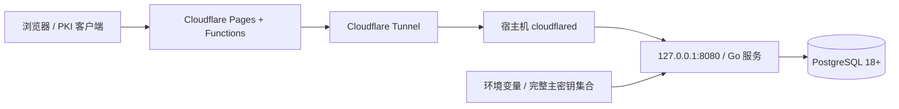

> 状态：历史归档。以下内容保留旧版本的部署与操作记录，不能作为当前环境状态或当前版本操作依据。
> 当前入口：[项目文档](../../README.md)、[部署指南](../../production-deployment.md)。

# PKI-Console 部署、迁移与数据导出手册

本文面向接手项目的运维人员，覆盖首次部署、从 systemd 切换到 Docker、跨主机迁移、数据库备份恢复和业务数据导出。按 2026-10-09 工作区源码核对；示例尚未在生产环境执行。所有域名、版本标签、文件路径和数据库账户应替换为实际值。

当前生产记录采用原生 Go + systemd。本文提供的 Docker 方案是可选部署方案，保留 Cloudflare Pages/Functions、宿主机 cloudflared 和独立 PostgreSQL。仓库根目录的 `Dockerfile`、`Dockerfile.alpine` 是旧 CFSSL CLI 配置，不能用于这里的 Console 服务。

## 1. 部署边界与准备



| 项目 | 要求 |
| --- | --- |
| 应用主机 | Linux；Docker 方案使用 Docker Engine 与 Compose v2、host 网络 |
| Go 构建 | 遵循 `go.mod`；当前声明 `go 1.26.0`、`toolchain go1.27.0`，预装相应工具链 |
| Web 构建 | 遵循 `web/package.json` 与 lock 文件；当前声明 Node >=20.19、npm 11.9.0，实际 Node 还需满足锁定依赖的 engines |
| 数据库 | PostgreSQL 18+，迁移依赖内置 `uuidv7()`；数据库单独管理和备份 |
| 域名 | 公共域名、Console 域名、Tunnel origin 域名；沿用已签发证书中的公共地址 |
| 认证 | Console 的 Cloudflare Access、Team Domain/AUD、root 邮箱/密码/SHA256 TOTP |
| 时间 | 宿主机 NTP 正常；TSA 必须能读取 Linux 内核同步状态 |
| 数据工具 | PostgreSQL 客户端工具、Python 3（本文 ready 检查）、OpenSSL；加密备份示例使用 GnuPG |

程序只支持 `serve`、`worker`、`migrate`、`healthcheck`，没有 `backup`、`restore` 或全量 `export` 子命令。`serve` 已内置签发 worker，首次部署无需额外启动 worker。

业务数据全部在数据库中；CA、OCSP、TSA 及尚可下载的叶私钥以加密形式存储。`PKI_MASTER_KEYS` 位于进程环境，必须另行保管。容器镜像、证书 PEM 文件或 CSV 报表都不能单独恢复系统。

## 2. 首次部署的公共步骤

### 2.1 建库、账户和配置

按 [生产部署手册第 5–7 节](../../production-deployment.md) 创建数据库及 owner 角色、配置 Pages/Access/Tunnel。初始化数据库时验证：

```sql
SHOW server_version;
SELECT uuid_extract_version(uuidv7());
```

结果应为 PostgreSQL 18+ 和 `7`。运行角色需要当前审计分区机制所需的 schema 创建权限，不能直接套用只允许 DML 的角色模板。

从仓库 `.env.example` 制作 `/etc/pki-console/pki-console.env`。首次创建时用新随机值替换全部示例密钥；迁移已有实例时保留原来的完整密钥集合。只在可信编辑器或密钥管理系统中处理凭据，不把真实配置提交到 Git。

关键变量：

| 变量 | 配置原则 |
| --- | --- |
| `DATABASE_URL` | 同机显式 `127.0.0.1` 可以 `sslmode=disable`；远程使用 `sslmode=verify-full` 并配置受信任 CA |
| `PKI_LISTEN_ADDRESS` | 生产使用 `127.0.0.1:8080`，源码会拒绝非回环监听 |
| `PKI_DEVELOPMENT_INSECURE` | 生产固定 `false` |
| `PKI_MASTER_KEYS` / `PKI_MASTER_KEY_ACTIVE_ID` | 完整 JSON 密钥映射与当前 key ID；必须保留仍被历史数据或备份引用的旧 key |
| `ROOT_USER_EMAIL` / `ROOT_USER_PASSWORD` / `ROOT_USER_TOTP_SECRET` | 邮箱与 Access 身份匹配；密码至少 32 字符；TOTP 为 SHA256、6 位、30 秒 |
| `CF_ACCESS_TEAM_DOMAIN` / `CF_ACCESS_AUD` | 与 Console 的 Access 应用一致 |
| `PKI_ORIGIN_SHARED_SECRET` | 64 个十六进制字符，与 Pages Secret 一致 |
| `PUBLIC_BASE_URL` / `CONSOLE_BASE_URL` | 两个不同的 HTTPS origin；迁移优先保留原值 |
| `TRUSTED_PROXY_CIDRS` | 宿主机 cloudflared 场景使用 `127.0.0.1/32,::1/128` |
| `TSA_MAX_CLOCK_UNCERTAINTY` | 默认 `5s`；不能通过放宽限制代替修复 NTP |

环境文件使用 `KEY='value'` 格式，无 `export`，值不引用其他变量；JSON 外层单引号、内部双引号。保持文件权限 `0600`（Docker 管理员读取）或 `root:pki-console 0640`（systemd 服务读取）。环境文件备份属于密钥材料。

### 2.2 构建、前端和入口

从确定的 commit/tag 构建并记录 commit、工具链、二进制校验和：

```bash
go test ./console/... ./cmd/pki-console
go vet ./console/... ./cmd/pki-console
make -B pki-console TARGETOS=linux TARGETARCH=amd64
sha256sum bin/pki-console
cd web
npm ci
npm run check
```

ARM64 主机改为 `TARGETARCH=arm64`。`-B` 确保切换架构或版本后重新构建。

在 `web` 目录按 [生产部署手册](../../production-deployment.md) 配好 Wrangler 项目、两个业务域名、`PKI_ORIGIN_URL`、`PKI_PUBLIC_HOST`、`PKI_CONSOLE_HOST` 和加密 Secret 后发布：

```bash
npx --no-install wrangler pages deploy dist --project-name pki-web --branch main
```

需要同时部署 `web/functions`，不能只把静态文件复制到普通 Web 服务器。仅 Console 域名启用 Access；公共 PKI 域名保持匿名可访问。宿主机 cloudflared 的 origin 指向 `http://127.0.0.1:8080`。具体资源配置沿用生产手册，不需要新增 Nginx。

### 2.3 选择 systemd 部署

如果继续使用原生方式，按 [生产部署手册第 4、8–11 节](../../production-deployment.md) 安装二进制、服务账户和 unit，先执行 `migrate`，再启动服务。数据库与密钥的备份、迁移、导出流程同样适用本文第 5–8 节。

## 3. Docker 部署示例

### 3.1 制作只包含发布产物的镜像

本方案先构建静态二进制，再制作运行镜像，避免把源码目录、`.env.local`、临时私钥或前端依赖发送到 Docker 构建上下文。在构建机仓库根目录执行：

```bash
PKI_IMAGE_TAG="$(git rev-parse --short=12 HEAD)"
PKI_IMAGE_CONTEXT="$(mktemp -d)"
install -m 0755 bin/pki-console "$PKI_IMAGE_CONTEXT/pki-console"
cat > "$PKI_IMAGE_CONTEXT/Dockerfile" <<'DOCKERFILE'
FROM debian:bookworm-slim
RUN apt-get update && apt-get install -y --no-install-recommends ca-certificates \
    && rm -rf /var/lib/apt/lists/*
COPY --chmod=0555 pki-console /usr/local/bin/pki-console
USER 65532:65532
ENTRYPOINT ["/usr/local/bin/pki-console"]
CMD ["serve"]
DOCKERFILE
docker build --platform linux/amd64 \
  -t "pki-console:$PKI_IMAGE_TAG" "$PKI_IMAGE_CONTEXT"
docker image inspect "pki-console:$PKI_IMAGE_TAG" --format '{{.Id}}'
```

二进制与镜像目标架构必须相同。正式发布应锁定已验证的基础镜像 digest，记录最终镜像 ID/digest，并保留上一版本。系统 CA 证书用于 Access JWKS 等 HTTPS 出站连接。

向部署主机传输镜像可以使用私有仓库，或保存镜像归档：

```bash
docker image save -o "pki-console-$PKI_IMAGE_TAG.tar" "pki-console:$PKI_IMAGE_TAG"
sha256sum "pki-console-$PKI_IMAGE_TAG.tar" > "pki-console-$PKI_IMAGE_TAG.tar.sha256"
```

在目标机校验后 `docker image load -i <镜像归档路径>`。镜像归档只包含程序，不是数据库备份。

### 3.2 创建 Compose 配置

在主机创建 `/opt/pki-console/compose.yaml`，将 `REPLACE_WITH_RELEASE_TAG` 替换为已加载镜像标签：

```yaml
name: pki-console
services:
  api:
    image: pki-console:REPLACE_WITH_RELEASE_TAG
    network_mode: host
    env_file:
      - /etc/pki-console/pki-console.env
    command: ["serve"]
    restart: unless-stopped
    read_only: true
    user: "65532:65532"
    cap_drop: ["ALL"]
    security_opt:
      - no-new-privileges:true
    stop_grace_period: 30s
    healthcheck:
      test: ["CMD", "/usr/local/bin/pki-console", "healthcheck"]
      interval: 30s
      timeout: 5s
      retries: 3
      start_period: 20s
    logging:
      driver: json-file
      options:
        max-size: "10m"
        max-file: "5"
```

Linux host 网络使容器能够访问宿主机的回环服务，不配置 `ports:`。这与代码要求的回环监听一致；普通 bridge 网络下直接将监听改成 `0.0.0.0` 会被配置校验拒绝。[Docker host 网络说明](https://docs.docker.com/engine/network/drivers/host/)。

这里使用 Compose 的服务级 `env_file`。不要用 `docker run --env-file` 直接替换，它对外层引号的处理不同；也不要把 Compose 命令级 `--env-file` 当作服务环境注入。避免 `docker compose config` 不带 `--quiet` 时将秘密展开到终端或 CI 日志。[Compose 环境变量说明](https://docs.docker.com/compose/how-tos/environment-variables/envvars-precedence/)。

远程数据库若依赖自有 CA，需要在服务中添加只读文件挂载，并把 `DATABASE_URL` 的 `sslrootcert` 指向容器内路径；保证 UID 65532 可读。环境中的宿主机文件路径不会自动在容器中存在。

### 3.3 迁移并启动

下列命令在部署主机 `/opt/pki-console` 执行。已有生产数据库先完成第 5 节备份；不要同时运行旧 systemd 服务和新容器占用 8080。

```bash
cd /opt/pki-console
docker compose config --quiet
docker compose run --rm --no-deps api migrate
docker compose up -d api
docker compose ps
docker compose exec -T api /usr/local/bin/pki-console healthcheck
docker compose logs --tail=100 api
```

`migrate` 会校验整套环境变量，不是只读取数据库 URL。它只执行向上迁移；没有应用级 `migrate down` 命令。不要在空库先运行迁移后再向同一库恢复全量备份。

本 Compose 的 healthcheck 只验证进程存活；Docker 报 `healthy` 不等于数据库或签发业务正常，`unhealthy` 也不会仅凭 restart policy 自动重启。继续执行下一节验收。

## 4. 上线验收与日常操作

### 4.1 数据库就绪检查

当前 `cmd/pki-console/main.go` 的 `healthcheck` 调用 `/api/v1/health/live`。真正会 Ping 数据库的是 `/api/v1/health/ready`。

在宿主机以有权读取环境文件的账户执行下列独立脚本。环境文件必须可信且符合前述 shell 格式；秘密通过环境传递，不拼进 curl 命令参数：

```bash
#!/usr/bin/env bash
set -euo pipefail
set -a
. /etc/pki-console/pki-console.env
set +a
python3 - <<'PY'
import os
import urllib.request
from urllib.parse import urlsplit
host = urlsplit(os.environ['CONSOLE_BASE_URL']).netloc
request = urllib.request.Request(
    'http://127.0.0.1:8080/api/v1/health/ready',
    headers={'Host': host,
             'X-PKI-Forwarded-Host': host,
             'X-PKI-Origin-Secret': os.environ['PKI_ORIGIN_SHARED_SECRET']})
with urllib.request.build_opener(urllib.request.ProxyHandler({})).open(request, timeout=5) as response:
    print(response.status, response.read().decode())
PY
```

预期 `200` 和 `{"status":"ready"}`。这仍不能验证 KEK 解密、Access 登录或 TSA 时钟。

### 4.2 完整验收

- 公共 `/health/live` 与 `/pki/v1/authorities` 返回 200，匿名 origin 返回 403。
- Console 正常经过 Access，root 使用密码和 SHA256 TOTP 登录，普通用户权限正确。
- 核对已有 CA 指纹、证书数量、吊销状态、审计记录及历史 KEK 解密能力。
- 首次部署使用非生产 CA 完成申请、审批、签发、证书下载、吊销、CRL 和 OCSP 验证。
- 有 TSA 时按 [TSA 手册](../../tsa.md) 的 OpenSSL 流程验证；检查宿主机 NTP，以及容器 seccomp 是否允许只读 `adjtimex` 查询。不要以 `privileged` 或授予校时权限作为默认解决方案。

迁移恢复副本的测试不能签发正式生产证书或接入生产 Tunnel；先完成只读核对，再按隔离演练方案验证密钥。

### 4.3 常用操作

```bash
cd /opt/pki-console
docker compose ps
docker compose logs --since=30m --tail=200 api
docker compose stop api
docker compose start api
```

修改环境文件或镜像后使用 `docker compose up -d --force-recreate api`，单纯 `restart` 不会重新注入环境文件。版本升级先备份，停止所有应用写入者，再运行新镜像 `migrate`、重建服务并验收。每个额外 worker 也必须同步版本和配置；跨主机运行时使用不同 hostname，便于区分 worker 日志与锁持有者。

## 5. 全量备份与恢复

### 5.1 一份可恢复备份包含什么

| 材料 | 用途 |
| --- | --- |
| 完整 PostgreSQL dump 或数据库平台的物理备份/WAL | 用户、CA、证书、工作流、队列、审计链及分区、OCSP、TSA、版本表等 |
| 全部历史 `PKI_MASTER_KEYS` 和 active ID | 解密现存和历史备份中的私钥密文 |
| 环境配置的加密副本 | root/TOTP、数据库连接、origin secret、Access 与域名配置 |
| 应用镜像/二进制、commit 和校验和 | 恢复相匹配的程序版本 |
| Pages/Functions 版本、Tunnel/Access/DNS 配置 | 恢复访问入口与身份认证 |
| 备份时间、数据库版本、schema 版本、恢复记录 | 明确恢复点及兼容性 |

数据库备份和含 KEK 的材料分别加密、分别授权保存。dump 内还包括用户密码哈希、会话等敏感数据。不要通过工单、Git 或聊天传输明文备份。

### 5.2 配置数据库工具连接

以下示例在装有 PostgreSQL 18 客户端的受控运维主机执行，`pg_dump` 不得低于源库主版本；本文推荐源库、目标库和工具均先采用相同的 18 主版本。升级数据库另开变更窗口。

在运维账户 `~/.pg_service.conf` 中配置连接，不写密码：

```ini
[pki_source]
host=127.0.0.1
port=5432
dbname=pki_console
user=pki_console
sslmode=disable

[pki_restore]
host=127.0.0.1
port=5432
dbname=pki_console_restore
user=pki_console
sslmode=disable
```

用 `~/.pgpass` 保存对应口令并设置 `chmod 600 ~/.pgpass`，格式为 `host:port:database:user:password`；密码中的 `:` 和反斜杠须转义。远程连接改为实际 hostname、`sslmode=verify-full` 和 `sslrootcert`。目标服务条目必须明确指向新库，不能误指生产库。

```bash
PGSERVICE=pki_source psql -X -v ON_ERROR_STOP=1 -c 'SELECT current_database(), current_user, version();'
```

### 5.3 创建逻辑备份

下列块作为一个 Bash 脚本执行；示例落盘位置应位于受控加密存储。把 GPG 收件人替换为已验证的备份公钥指纹；恢复私钥另行保管：

```bash
set -euo pipefail
umask 077
PKI_BACKUP_DIR="/var/backups/pki-console/$(date -u +%Y%m%dT%H%M%SZ)"
install -d -m 0700 "$PKI_BACKUP_DIR"
PGSERVICE=pki_source pg_dump --format=custom \
  --file="$PKI_BACKUP_DIR/database.dump"
pg_restore --list "$PKI_BACKUP_DIR/database.dump" > "$PKI_BACKUP_DIR/archive.list"
PGSERVICE=pki_source psql -X -v ON_ERROR_STOP=1 \
  -c 'SELECT * FROM goose_db_version ORDER BY id;' > "$PKI_BACKUP_DIR/schema-version.txt"
gpg --batch --encrypt --recipient REPLACE_WITH_BACKUP_PUBLIC_KEY_FINGERPRINT \
  --output "$PKI_BACKUP_DIR/database.dump.gpg" "$PKI_BACKUP_DIR/database.dump"
(cd "$PKI_BACKUP_DIR" && sha256sum database.dump.gpg > SHA256SUMS)
```

确认加密文件可由恢复保管人解密、异地副本校验通过后，再按介质策略清理临时明文。不要把普通删除视为 SSD/快照上的可靠擦除。

`pg_dump` 生成一致性快照，可以在线日常备份；迁移最终切换需要停止所有写入者后再导出。全库 dump 包括分区和函数，但不包括集群级角色；目标角色按第 2 节重建。不要只备份几个主表。[PostgreSQL pg_dump 文档](https://www.postgresql.org/docs/18/app-pgdump.html)。

每日逻辑备份不等于 PITR。需要分钟级 RPO 时，由数据库平台配置基础备份和连续 WAL 归档，并验证实际恢复能力。

### 5.4 恢复到一个新的空数据库

由 DBA 创建 `pki_console_restore`，owner 为应用角色，使用 `template0`、UTF8，并应用第 2 节的数据库/schema 权限。不要先执行应用迁移，禁止直接覆盖运行中的生产库。

在恢复工作目录放入加密文件与 `SHA256SUMS`，执行：

```bash
set -euo pipefail
umask 077
sha256sum -c SHA256SUMS
gpg --output database.dump --decrypt database.dump.gpg
pg_restore --list database.dump > archive.list
PGSERVICE=pki_restore psql -X -v ON_ERROR_STOP=1 \
  -c 'SELECT current_database(), current_user;'
PGSERVICE=pki_restore pg_restore --dbname='service=pki_restore' \
  --no-owner --no-privileges --exit-on-error --single-transaction database.dump
PGSERVICE=pki_restore psql -X -v ON_ERROR_STOP=1 -c 'ANALYZE;'
```

恢复使用应用 owner 角色；`--no-owner --no-privileges` 避免依赖源环境角色和 ACL，额外只读/监控账户的权限需要重新授予。恢复报错时保留日志并重新准备空库，不要忽略错误继续上线。[PostgreSQL pg_restore 文档](https://www.postgresql.org/docs/18/app-pgrestore.html)。

恢复后先核对迁移版本、主要表数量、CA 指纹和审计分区，再安装匹配版本程序、配置完整 KEK、将 `DATABASE_URL` 指向恢复库。确认恢复无误后执行对应版本 `migrate`，完成当前及下月审计分区准备，再启动并验收。

```sql
SELECT * FROM goose_db_version ORDER BY id;
SELECT 'users' AS relation, count(*) FROM users
UNION ALL SELECT 'certificate_authorities', count(*) FROM certificate_authorities
UNION ALL SELECT 'certificates', count(*) FROM certificates
UNION ALL SELECT 'revocations', count(*) FROM revocations
UNION ALL SELECT 'audit_events', count(*) FROM audit_events
UNION ALL SELECT 'timestamp_tokens', count(*) FROM timestamp_tokens;
SELECT inhrelid::regclass FROM pg_inherits WHERE inhparent = 'audit_events'::regclass;
SELECT scope, encode(head_hash, 'hex') FROM audit_chain_heads ORDER BY scope;
```

与同一备份时点的源库记录比对。数量与链头一致只属于初步核对，不能代替审计链完整性验证及私钥解密演练。

## 6. 迁移流程与回退

### 6.1 同机 systemd 切换到 Docker，继续使用原数据库

1. 记录现有版本、配置位置、域名和数据状态，完成数据库及密钥备份。
2. 用相同 commit 构建镜像，准备 Compose，保持数据库地址和 KEK 不变。
3. 在维护窗口停止 `pki-console.service` 及全部独立 worker；避免旧进程自动拉起。
4. 执行容器 `migrate`，启动 `api`，完成 live、ready、登录与公共 PKI 验收。
5. 验收通过后禁用旧应用 unit 开机自启，保留旧二进制与配置用于回退；保留 cloudflared 和数据库服务。

同库、同版本且 schema 兼容时，可停止容器再启动旧 systemd 服务回退，无需导入 dump。数据库本身不需要因应用容器化搬家。

### 6.2 更换主机或迁移数据库

1. 在目标主机准备同版本程序、PostgreSQL、完整密钥配置和网络，先做隔离恢复演练；禁止让演练副本写生产库。
2. 预约维护窗口。准备好新旧 Tunnel 的路由切换方案，保证最后只指向目标应用。
3. 停止源端所有 `serve`、独立 `worker`、定时作业及其他数据库写入者；`serve` 自带 worker，单纯屏蔽浏览器不足以停止写入。
4. 生成最终 dump，记录截止时间、schema、表数量、CA 指纹和审计链头，并加密传输与校验。目标演练库有写入时，重新建空库恢复最终备份。
5. 按第 5.4 节恢复；迁移配置中的完整 KEK、root/TOTP、origin secret、Access 与两个业务域名。需要时调整数据库 URL 和证书挂载路径。
6. 在目标运行 `migrate`，启动后本地验证 live/ready；源端继续保持停止。切换 Tunnel/入口，使请求只到目标。
7. 完成外网验收、业务检查和日志观察，记录实际停机时间与恢复点，再移除旧主机的生产连接能力。

旧 Tunnel 同时连接新旧主机时，流量可能仍被分配给旧 Connector。不要把“添加新 Connector”当成确定的单向切换；应停掉旧 Connector 或使用明确的新 Tunnel origin 路由，并同步 Pages 绑定。

保留 `PUBLIC_BASE_URL` 特别重要：已有证书的 AIA、CRL、OCSP URI 已写入证书，修改环境变量不会改写它们。确需换域名时仍要维护旧公共端点的协议兼容服务，直到相关证书不再依赖它。

### 6.3 回退条件

| 时点 | 处理方式 |
| --- | --- |
| 新库尚未接受业务写入 | 停止目标服务，确认源库仍是最终状态后将路由切回源端 |
| 目标已产生签发、吊销、TSA 或审计记录 | 不能直接启动旧快照；冻结写入，以目标最新完整数据反向迁移或前向修复 |
| 升级包含 schema 变更 | 先验证旧二进制兼容性；不能假设换回镜像即可回退 |
| 灾难恢复只能回到较早备份 | 明确丢失区间，核对区间内签发与吊销；不能把丢失的证书状态当作从未发生 |

不允许新旧两个独立数据库同时对同一套 CA 提供正式服务。恢复旧快照可能回退吊销状态、审计链和一次性私钥下载状态，需要专项核对。

## 7. 数据导出

### 7.1 按用途选择

| 需求 | 方法 | 是否能恢复整个系统 |
| --- | --- | --- |
| 换主机、灾备 | 完整数据库备份 + 全部 KEK + 配置及应用版本 | 是，需验证 |
| 台账、到期统计 | 只读 SQL 导出 CSV | 否 |
| 审计归档 | 指定时段 JSONL/CSV，保留链相关字段 | 否 |
| 证书交付 | Console 下载证书链，或指定证书的 API | 否 |
| CA 私钥交接 | root 强认证导出，立即加密保管 | 否 |
| 叶私钥 | 申请人按一次性下载流程获取 | 否；已擦除内容不能通过当前数据库导出 |

### 7.2 导出证书台账 CSV

在受控目录执行，只选择业务字段，不使用 `SELECT *` 导出密钥、会话或用户表。以下命令将证书序列号转为文本，导入 Excel 时也必须将该列设为文本，避免超过 15 位后精度丢失。

```bash
umask 077
PGSERVICE=pki_source psql -X -v ON_ERROR_STOP=1 <<'SQL'
BEGIN ISOLATION LEVEL REPEATABLE READ READ ONLY;
SET LOCAL TIME ZONE 'UTC';
\copy (SELECT c.id, ca.slug AS issuer, c.serial::text AS serial, encode(c.fingerprint_sha256,'hex') AS sha256, c.status, c.not_before, c.not_after, c.subject::text AS subject FROM certificates c JOIN certificate_authorities ca ON ca.id=c.issuer_ca_id ORDER BY c.created_at,c.id) TO 'certificate-inventory.csv' WITH (FORMAT csv, HEADER true, ENCODING 'UTF8')
COMMIT;
SQL
```

`\copy` 文件写在运行 psql 的客户端。导出的 subject 等用户输入字段应按纯文本导入电子表格，避免被解释为公式。数据量很大时增加日期过滤或在受控只读副本导出，并记录副本延迟。

### 7.3 导出审计 JSONL

按半开区间导出，明确使用 UTC；修改下列日期即可：

```bash
umask 077
PGSERVICE=pki_source psql -X -qAt -v ON_ERROR_STOP=1 > audit-events.jsonl <<'SQL'
BEGIN ISOLATION LEVEL REPEATABLE READ READ ONLY;
SET LOCAL TIME ZONE 'UTC';
SELECT row_to_json(a)::text FROM audit_events a
WHERE occurred_at >= '2026-10-01T00:00:00Z'::timestamptz
  AND occurred_at <  '2026-11-01T00:00:00Z'::timestamptz
ORDER BY occurred_at,id;
COMMIT;
SQL
sha256sum audit-events.jsonl > audit-events.jsonl.sha256
```

查询父表会包含其分区，输出保留 `prev_hash`、`event_hash` 等字段。单月导出缺少前后链上下文，不能独立证明整个审计链完整；完整恢复仍需全库及 `audit_chain_heads`。审计可能包含用户标识、IP 和业务元数据，应按受控数据归档。

### 7.4 证书和私钥导出

优先使用 Console 的证书下载与 CA 密钥导出界面，避免手工复制浏览器 Cookie/JWT。对接自动化时以 [OpenAPI](../../openapi.yaml) 和 [客户端接入说明](../../desktop-client-integration.md) 为准：

| 接口 | 行为与约束 |
| --- | --- |
| `GET /api/v1/certificates/{id}/download` | 下载 PEM 证书链，受当前用户可见范围限制 |
| `POST /api/v1/cas/{id}/keys/export` | CA 私钥导出；要求 root、有效 Access、密码和新 TOTP，并记录审计 |
| `POST /api/v1/certificates/{id}/private-key/download` | 申请人的一次性叶私钥下载，遵循下载 token、有效期及已擦除状态校验 |

POST 操作还需按当前会话协议携带 CSRF 信息。CA 私钥响应为 PEM，导出后应立即在受控位置加密；不能作为普通附件发送。不要为方便迁移批量导出明文 CA 私钥，完整数据库与 KEK 足以恢复系统。

用户自行生成 CSR 的私钥从未上传到服务端；已下载并擦除的服务端叶私钥也不能从当前库重新获得。旧备份可能含擦除前的密文，因此仍需敏感备份的访问控制和保留策略。

## 8. 故障定位与交接记录

| 现象 | 优先检查 |
| --- | --- |
| 容器启动提示必须 loopback | `PKI_LISTEN_ADDRESS`、host 网络配置 |
| `address already in use` | 旧 systemd 或其他容器占用 8080 |
| 数据库连接失败 | host 网络、数据库实际监听、URL 密码编码、远程 TLS/CA 挂载 |
| Docker healthy，但 API 数据操作失败 | 单独检查 ready、数据库权限和 worker 日志 |
| 页面正常但 API 403/421 | Pages Function、origin secret、两个业务 hostname 和可信代理 |
| 恢复后无法签发/解密 | 是否遗漏旧 KEK ID、Base64/JSON 是否因环境格式改变 |
| TSA `timeNotAvailable` | 主机 NTP、内核同步标记、容器查询权限与不确定度 |
| 更新配置后仍用旧值 | 是否执行 Compose 容器重建 |
| 迁移时 `uuidv7()` 不存在 | PostgreSQL 主版本低于 18 |

每次变更记录源/目标主机、应用 commit 与镜像 ID、数据库/schema 版本、备份 ID、校验结果、密钥保管位置（不记密钥值）、切换时间、live/ready 与业务验收、回退条件和负责人。

本文示例只完成源码与命令结构核对，不代表已完成 Docker 构建、真实数据库恢复或生产演练。首次使用前在隔离环境执行一次完整部署和恢复，记录实际 RPO/RTO；之后定期重复恢复演练。日常告警、保留周期和事件处置见 [运维 Runbook](operations-runbook.md)。
