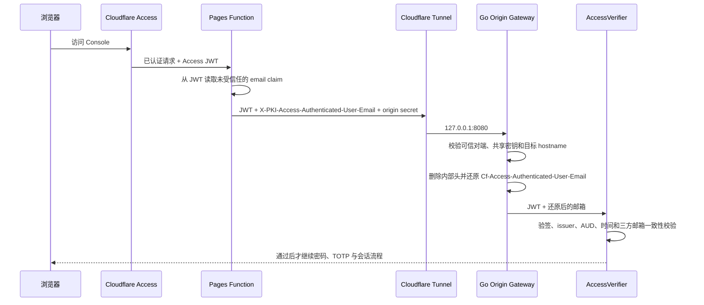

> 历史文档：本文中的 Cloudflare / Pages / Access / Tunnel 部署步骤适用于旧版本。
> 当前单体应用使用本地密码/TOTP、外部 PostgreSQL 和 Nginx，部署与迁移以
> [production-deployment.md](production-deployment.md) 为准；Web 业务流程与数据库操作请结合当前版本核对。

# 2026-08-24 超级管理员登录故障复盘

状态：已解决。生产用户已完成真实登录验证。

## 事件摘要

`pki-console.altasci.com` 的 Cloudflare Access 登录正常，但超级管理员在
PKI-Console 登录页提交正确的邮箱、密码和 TOTP 后，持续收到统一的“认证未通过”提示。
公共 PKI 页面、Go 服务、PostgreSQL 和 Tunnel 在事件期间均保持可用。

影响范围仅限超级管理员建立新的 PKI-Console 会话。系统没有签发错误、密钥泄漏、
数据损坏或 Access 绕过。普通公开查询不受影响。

## 根因

Cloudflare Access JWT 已到达 Pages Function 和 Go 后端，但 Pages Function 向
`pki-origin.altasci.com` 发起子请求时，保留名称
`Cf-Access-Authenticated-User-Email` 没有到达 Go 进程。后端按照既定安全要求同时
校验 Access JWT、Access 邮箱头和 `ROOT_USER_EMAIL`，因此正确拒绝了缺少邮箱头的
请求。

生产安全诊断日志给出了不含凭据的直接证据：

```text
login_matches_root=true
access_jwt_present=true
access_email_present=false
access_email_matches_root=false
error="invalid credentials at access: Cloudflare Access email does not match root identity"
```

密码和 TOTP 不是本次故障原因。登录失败计数没有增加，root 用户也没有被锁定。

## 修复后的认证链路



Pages Function 对 JWT payload 的读取只用于跨代理传输邮箱，不能建立信任。最终信任
仍由 Go 后端通过以下全部条件共同建立：

1. TCP 对端属于 `TRUSTED_PROXY_CIDRS`；
2. `PKI_ORIGIN_SHARED_SECRET` 通过恒定时间比较；
3. 转发目标是配置中的 Console hostname；
4. Access JWT 签名、issuer、AUD、`exp` 和 `nbf` 均有效；
5. JWT email、还原后的邮箱头和 `ROOT_USER_EMAIL` 完全一致；
6. root 密码和不可重放的 SHA-256 TOTP 均正确。

Function 和 Go 网关都会先删除客户端可伪造的内部邮箱头。公共
`pki.altasci.com` 请求不会桥接 Access 身份，也不会向公共 PKI API 转发 Console
Cookie 或认证头。

## 同期发现的问题

诊断期间还发现登录审计事件在没有附加 metadata 时可能向 PostgreSQL 写入 `NULL`，
与 `audit_events.metadata NOT NULL` 冲突。审计写入现在会把空 metadata 规范化为
JSON 对象 `{}`，并已通过测试。该问题没有改变登录判定，但会造成失败登录审计缺失。

第一次后端滚动更新的健康检查紧跟在 `systemctl restart` 后执行，服务尚未监听时收到
一次 `connection refused`，自动回滚机制按设计恢复了旧版本。第二次更新改用最多
15 秒的短间隔健康检查重试后成功。后续发布 Runbook 已固化“等待 ready，而非只相信
systemctl restart 返回值”的要求。

## 验证结果

- Go 单元测试、集成包测试和 `go vet` 通过；
- 前端 ESLint、TypeScript、Vitest、Vite production build 和 Pages Functions build
  通过；
- 新生产二进制 SHA-256 与本地构建产物一致；
- `pki-console.service` 为 `active`，内置 healthcheck 通过；
- `https://pki.altasci.com/`、`/health/live` 和 `/pki/v1/authorities` 返回 200；
- 不带共享密钥访问 `pki-origin.altasci.com` 返回 403；
- Console hostname 返回 Cloudflare Access 跳转；
- 超级管理员完成真实密码、TOTP 和 Access 登录，确认故障关闭。

## 后续防复发要求

- 保留 origin gateway 的 Console 邮箱桥接测试、公共 hostname 身份清除测试和 Access
  JWT claim 解析测试；
- 不再假设 Cloudflare 保留跨子请求的 `Cf-Access-*` 头；
- 登录失败只向浏览器返回统一错误，详细阶段仅写入不含密码、TOTP、JWT 和 Secret 的
  服务端结构化日志；
- 发布时必须保留上一版二进制，并在 restart 后循环检查 ready；
- Access 登录异常先按本文的安全字段判断阶段，不连续试错以免触发账户锁定；
- 修改 Pages Function、origin gateway 或 Access 应用后必须完成真实 root 登录验收。

日常检查和处置命令见 [operations-runbook.md](operations-runbook.md)。当前 Cloudflare
资源见 [cloudflare-wrangler-operations.md](cloudflare-wrangler-operations.md)。
